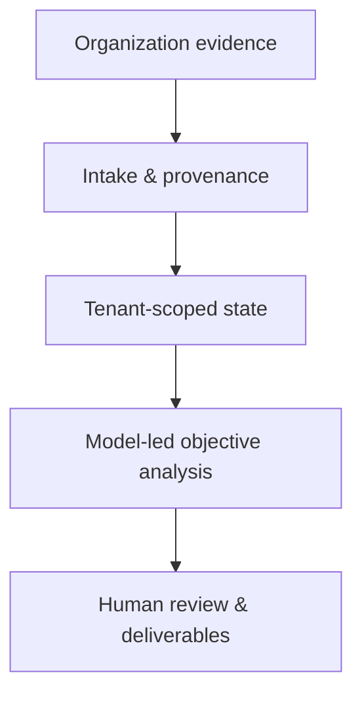

# COSINE

### AI-assisted CMMC Level 2 compliance-readiness engineering

**Private-source software project | Active development | Not a released or certified compliance product**

COSINE is a compliance-readiness platform being developed by **Cosinetech** to help organizations organize security evidence and prepare for assessments against **CMMC Level 2** and **NIST SP 800-171 Rev. 2**. The goal is a chat-first workspace that connects security records, assessment objectives, follow-up questions, remediation work, and draft documentation to one traceable engagement state.

This public repository is a **project showcase and engineering overview**. It does not contain the proprietary COSINE source code, customer data, credentials, deployment configuration, or private test artifacts.

## The problem

Security evidence is rarely a clean checklist. Teams work with spreadsheets, policies, screenshots, exports, PDFs, changing system inventories, incomplete records, and conflicting dates. COSINE is being engineered to help assess that messy evidence without mistaking a document's existence for proof that a requirement is satisfied.

The intended outputs are objective-level readiness judgments:

| Outcome | Meaning |
| --- | --- |
| `LIKELY_MET` | Evidence appears sufficient for the defined objective and scope. |
| `LIKELY_NOT_MET` | Evidence indicates a requirement is not implemented or otherwise not satisfied. |
| `NEEDS_HUMAN_REVIEW` | A qualified reviewer must resolve uncertainty or conflicting evidence. |
| `INSUFFICIENT_EVIDENCE` | The available evidence cannot support a defensible judgment. |

These are **readiness assessments**, not certification results. Human reviewers retain approval and release authority.

## Engineering work represented by the private prototype

The private COSINE codebase has been developed through multiple bounded implementation and adversarial-review cycles. Engineering areas include:

- **Evidence intake and provenance:** tracking source identity, version/supersession, extraction limitations, and exact evidence references.
- **Structured engagement memory:** tenant- and engagement-scoped facts, objective status, evidence dependencies, contradictions, and next actions.
- **Assessment safety controls:** separating absent evidence from affirmative nonimplementation; protecting against unsupported positive judgments and unnecessarily conservative outcomes.
- **Review and document workflows:** human-approval boundaries and evidence-grounded draft artifact workflows for assessment documentation.
- **Automated quality checks:** synthetic, non-customer test scenarios, negative/adversarial cases, regression checks, and independent reviewer findings that drive focused repairs.

These describe **development work and architecture under review**, not a claim that the entire product is complete, deployed, or independently qualified.

## Conceptual system architecture

**Design principle:** AI models interpret the substance of evidence; deterministic software enforces boundaries such as access control, source integrity, scope, citation eligibility, freshness, versioning, and cost limits. The target architecture uses AWS Bedrock for semantic assessment and a separate challenge/review stage for difficult or high-risk judgments. The diagram represents **design intent**, not a verified production deployment.

### Technologies and design choices

| Area | Technology / approach | Status |
| --- | --- | --- |
| Backend and test harnesses | Python, typed interfaces, automated testing | Private development candidates |
| Structured persistence | SQLAlchemy interfaces; SQLite for development/testing | Private development; production hardening remains |
| Production database | PostgreSQL | Architecture target; not claimed deployed |
| AI assessment | Anthropic Claude models via AWS Bedrock | Target integration; live accuracy not claimed |
| Cloud infrastructure | AWS networking, identity, storage, database, monitoring, and encryption services | Planned deployment architecture; deployment on hold |
| Document support | Evidence-linked document and template workflows | Private development; end-to-end release qualification pending |

## How development is being managed

COSINE follows a **bounded build → independent review → repair → verified checkpoint** workflow:

1. Define one coherent behavior change and its acceptance tests.
2. Implement only the approved scope in the private codebase.
3. Test with synthetic evidence, including failures, contradictions, and incomplete data.
4. Independently review actual code changes and test evidence; repair confirmed findings.
5. Preserve the reviewed state before starting the next phase.

**Accuracy is evaluated in both directions.** A false positive (`LIKELY_MET` without support) is a severe safety defect, but missed legitimate positive or negative findings are defects too. Sending every objective to human review is not the goal.

## Current focus and roadmap

| Workstream | Public status |
| --- | --- |
| Foundational evidence, state, and governance workflows | Developed in private candidates; qualification remains separate |
| Synthetic/offline testing and independent QA | Ongoing engineering practice; historical runs are not a production claim |
| Evidence Access Plane | Next bounded implementation phase: complete evidence inventory, exact retrieval, and snapshot consistency |
| Live model evaluation and full-client accuracy | Further validation required |
| Production cloud deployment and customer onboarding | Not deployed / not announced |

The immediate engineering focus is ensuring the assessor can access the **right complete evidence**, know what was actually retrieved, and avoid issuing a final assessment against stale or partially examined data.

## My role

**Emron Khairzad — Founder / Product & Engineering Lead**

I lead COSINE's product requirements, architecture direction, engineering scope, quality gates, and adversarial review process. Development uses AI-assisted implementation with separate independent code/test review; engineering claims are accepted only with evidence. The work combines cybersecurity compliance, cloud architecture, Python-based backend systems, data integrity, and AI reliability engineering.

## Responsible disclosure

- This repository is documentation-only. No COSINE implementation source code is published here.
- No customer security evidence, controlled unclassified information (CUI), private infrastructure details, secrets, or internal defect reports are included.
- Product features described as *planned*, *under development*, or *awaiting qualification* should not be interpreted as released capabilities.
- COSINE is not presented as an accredited C3PAO, an official CMMC certification service, or a substitute for qualified human assessment.

**Project owner:** [Emron Khairzad](https://github.com/Emron-Khairzad-Cosine)  
**Organization:** [Cosine Technologies](https://github.com/Cosine-Technologies)

